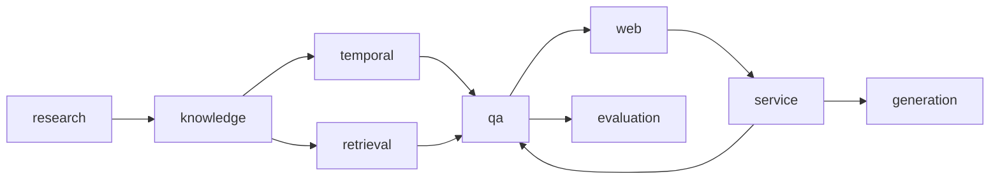

# 小组分工与交接

先克隆仓库并运行首页和 `npm run eval`。下表按三人小组给出建议组合，A/B/C 是可认领的工作角色。两人协作时，可以把运行服务交给 B、评测交给没有修改该算法的人；成员名单确定后再在 Issue 里认领。

| 模块 | 建议角色 | 负责内容 |
| --- | --- | --- |
| [research/](research/README.md) | 成员 A | 核对论文 §3.1–3.3、Fig. 2 与固定提交，说明真正可迁移的机制。 |
| [knowledge/](knowledge/README.md) | 成员 A | 维护原创课程资料、原子条款字段与独立研究引用表。 |
| [temporal/](temporal/README.md) | 成员 A | 以日期、组别和替代关系重建快照，保留并行有效与历史邻居。 |
| [retrieval/](retrieval/README.md) | 成员 A | 维护词法排序、主题路由、旧编号与旧值检索。 |
| [qa/](qa/README.md) | 成员 B | 把时间快照、检索命中和研究来源组织成带引用的回答。 |
| [generation/](generation/README.md) | 成员 B | 把选定证据送入真实本地 Qwen，并核验受约束输出。 |
| [web/](web/README.md) | 成员 B | 交付从提问到结论、原文、加入新条款、重新查询的操作闭环。 |
| [service/](service/README.md) | 成员 C | 维护网页资源入口、模型接口和运行环境边界。 |
| [evaluation/](evaluation/README.md) | 成员 C | 维护金标、消融、边界回归和逐题失败分析。 |

## 工作顺序

1. **建立共同输入。** A 核对研究摘记与资料字段，C 留存可复跑的评测基线和失败样例。B 用现有 `answer()` 接口并行推进界面、引用和模型整理。
2. **按模块开发。** A 优先处理 GNP08 并验证 X06/X07，B 验收部分未知与冲突呈现，C 从干净克隆复核模型可选路径和错误状态。如果改动会改变字段或函数签名，先写清影响的调用方。
3. **交叉验收。** 由另一位成员复现 PR 的查询和日期，查看证据编号、原文、失败与局限。最后由 C 集成并整理实际开发和部署记录。比赛需要的账号操作与对外发布另作确认。

## 接口流向

**一次查询的交接。** 知识条款含 `id/topic/value/text/scope/published/effective/imported/supersedes`，可附 `refs`。时序图按主题求合法视图，检索定位新旧证据，回答层按主题与组别输出结论、状态和编号。前端可以直接运行证据问答，也可以调用本地服务生成有编号的摘录。研究直查从固定来源表取页码或提交行号。

**提交流程。** 在对应 Issue 留言认领，从 `main` 创建主题分支，提交 PR 时写 `Closes #编号`，附改动前后样例与验证命令。还没有写权限的成员可以 fork 后提交 PR。工作不需要共享令牌；如要直接推送，由仓库所有者邀请具名成员。

**交付口径。** 记录真实实现工具和人工贡献。评测的当前依据集合、模型选句质量和部署可用性分别验收。公开内容包括独立实现和自编教学资料；原始论文、上游代码和下载的模型权重保留在各自的分发渠道。
