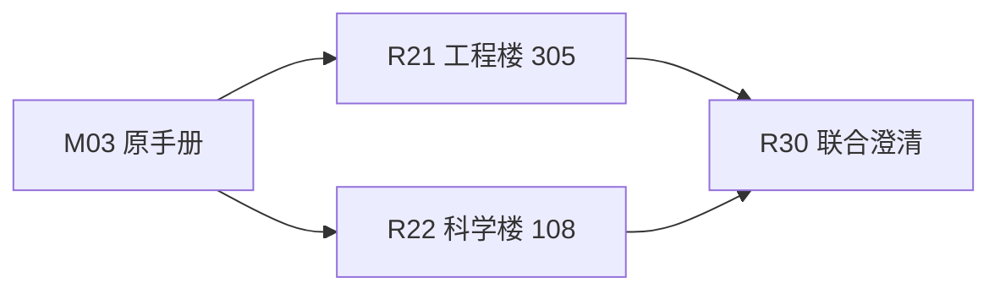

# 时知 NowPast RAG · 要求与任务

## 项目目标

参加阿里云 Qoder 高校创造力大赛，交付可运行、可核查来源、能处理规则随时间变化的课程问答原型。产品面向 GNP 复现实验课的学生和助教，按提问日期及 A/B 组确定当时可知且适用的要求。

RAG 引擎先检索证据，再组织带引用的结论。老师论文的原任务是动态图链路预测，项目采用受 Past/Now 分开建模思想启发的时序证据图和双通道检索。当前实现的可验收目标是课程证据选择、时间与组别归属、版本回查、冲突展示及模型引用。

本文件记录用户确认的要求与团队分工。论文、截图和课程资料用于提供事实与协作背景。工具使用和开发授权以用户在聊天中给出的要求为准。

## 协作分工

| 工作 | 负责人 | 目录与任务 |
|---|---|---|
| 页面设计、前端、研究说明、独立评测、最终集成 | 朋友／组长 | web、research、evaluation，对应 #1、#7、#9 |
| 数据、时间证据图、检索、回答、模型和服务 | 本聊天中的开发助手 | knowledge、temporal、retrieval、qa、generation、service，对应 #2、#3、#4、#5、#6、#8 |
| 接口变化、最终演示及比赛材料 | 双方协作 | 在 PR 中记录请求、响应、调用方和验证结果 |

范围依据最新 main 的 CONTRIBUTING.md。项目源码与日志提交到 GitHub 工作分支，通过 PR 交付供组长验收。每轮记录实际使用的开发工具与验证环境。

## 必须答对的场景

| 场景 | 预期行为 |
|---|---|
| 11 月 8 日 B 组问融合要求 | 当前依据 F01，同时展示已公布且 10 日生效的 B13 |
| 11 月 12 日 B 组问融合要求 | 当前依据 B13，保留 F01 的历史角色 |
| 同日 A 组问融合要求 | 按 F01，B 组补丁仅影响适用组别 |
| 11 月 14 日 B 组问验收地点 | 同时返回 R21、R22，明确材料冲突 |
| 11 月 15 日 B 组问验收地点 | 返回已公布的 R30，即使本机在 17 日才导入 |
| 学生拿旧排班“工程楼 305”提问 | 沿替代边找到后续澄清并定位原文 |
| 两个日期、多项要求一起问 | 分别生成快照，每个主题保留当时的证据角色 |
| 有依据的融合问题和未知设备费用混合提问 | 回答融合要求，单独提示费用缺少依据 |
| 两份当前通知并行生效 | 保留双方，明确替代关系出现后再更新结论 |
| 导入一份新的补充通知 | 校验字段及原文值，仅更新指定日期和适用范围 |
| 时间缺失、无效日期或无关问题 | 提示待核或证据不足 |

公布日决定历史查询能否知道该通知，生效日决定能否执行，导入日记录本机接收时间并约束未署公布日期资料。历史查询按当时已公布的资料回答。

## 研究核对

- 阅读组内 PDF 的 §3.1–3.3、Fig. 2，核对固定源码提交 `4bc08b4e818f3b70220f7f0234765b32b7fc403d`。
- 对照 PastGraph、Now、GNP.forward、Aggregator，记录论文 Hadamard 融合与源码拼接后线性投影的差异，以及平均消息与按时间选取消息的差异。
- 论文链路预测指标与课程问答证据指标分别记录。课程通知、组别、日期和补丁均来自自编演示资料，来源类型须明确。

## 共同接口

`answer(docs, question, {date, scope, mode, history})` 供页面和服务共同调用。前端消费 status、label、summary、sections、items、research 及日期和组别。每项结论携带可定位的条款编号和证据角色。

`POST /api/generate` 接收 `{docs, question, date, scope, mode}`，成功返回 `{model, text, citations}`。模型对候选原文选句，每条引用须在相同条款的原文中逐字存在。证据不足返回 422，模型不可用返回 503。模型缺失时页面仍可使用证据回答。

接口变更在 PR 中说明旧输入、新输出和受影响的前端位置，同时提供可执行样例。

## 当前任务与证据

| 任务 | 状态 | 验收证据 |
|---|---|---|
| #2 条款录入、原文值、双后继替代与范围隔离 | 已完成开发验证 | retrieval/regression.test.mjs，原有行为验收 |
| #3 当前／历史、公布与生效时间、冲突汇合 | 已完成开发验证 | 同上，见下方替代图 |
| #4 GNP08、X06、X07 及同类新问法 | 已修复并验证 | 原 38 题全部匹配，9 组开发回归通过 |
| #5 双日期、部分未知、研究来源和课程资料 | 已完成开发验证 | 原 22 项行为验收，回归检查与接口样例 |
| #6 真实 Qwen 调用与同来源引用 | Mac arm64 实测完成 | service/validation/api-results.json |
| #8 本机服务和页面模块、异常响应 | 已完成开发验证 | service/verify-service.mjs |
| 干净副本的一键验收 | 已通过，含真实模型 | service/verify-delivery.mjs、service/validation/delivery-check.json |
| 组长独立新题验收及最终集成 | 等待组长执行 | #9、PR #10 |
| Windows、Intel Mac 实机复测 | 待有对应环境时验证 | 当前已记录平台范围 |
| Qoder 开发过程、比赛部署和提交材料 | 后续共同阶段 | 以实际工具使用与比赛要求为依据 |

状态“已完成开发验证”对应本轮技术证据，Issue 的最终关闭由组长验收决定。开发回归由修改引擎的助手编写，独立评测由组长维护。



箭头表示旧条款被新条款明确替代。11 月 14 日 B 组同时保留 R21、R22，15 日公布 R30 后完成汇合。A 组继续适用 M03。

## 自动推进方式与本轮完成条件

用户授权继续推进直至与朋友当前阶段匹配。后续在本聊天中先检查 main、工作分支、PR 反馈和 Issues，再更新任务记录，处理属于引擎与服务范围的缺口，完成验证后提交 GitHub。日常修复、回归检查、兼容接口接入和日志更新可继续执行。

本轮把“进度匹配”落实为以下可检查条件。

1. 覆盖组长现有页面中的研究直查、指定日期问答、原文核查、录入后再查和真实模型入口。
2. #2、#3、#4、#5、#6、#8 的当前第一项交付具备代码或可复现验证证据。
3. 原 38 题、研究来源定位、GNP 角色和时间边界通过，开发新增问题单独记录。
4. 在干净副本从正常入口启动，得到真实模型成功响应及 422/503 错误响应。
5. 本文件、开发日志、接口样例和验收证据上传同一工作分支，PR 可供组长接入。

本次核对时，朋友可见的 main 为 `18f96ea`，本方 PR #10 头提交为 `d94f107`，暂未收到评审反馈。该结论只覆盖 GitHub 可见进度。后续有新提交或评审时，按同一流程接续推进。

本轮五项完成条件均已有技术证据。引擎与服务已经达到上述 main 页面可直接联调的交付阶段。干净副本验收通过当前依据 38/38、证据角色 9/9、研究来源 4/4、时间与更新行为 22/22、开发回归 9/9，以及三项真实模型和三项错误返回。待组长独立验收后决定 PR 合并与下一阶段范围。

## 交付位置与执行

仓库 https://github.com/666Dean/NowPast-RAG

工作分支 `codex/rag-engine-retrieval-model`，PR https://github.com/666Dean/NowPast-RAG/pull/10 。

```sh
node service/verify-delivery.mjs
```

模型已准备时，使用同一缓存目录执行完整验收。

```sh
NOWPAST_MODEL_HOME=/private/tmp/nowpast-models node service/verify-delivery.mjs --model
```

脚本在临时干净副本运行评测和服务检查，验证结果写入 service/validation/delivery-check.json。原始逐题金标仍由 evaluation/cases.mjs 提供。完整运行条件与模型准备见 generation/runtime.md，交付记录见 service/DELIVERY.md 和 service/DEVLOG.md。
